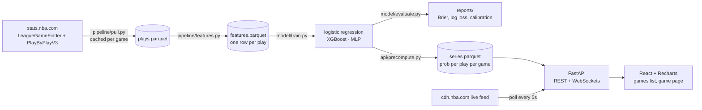
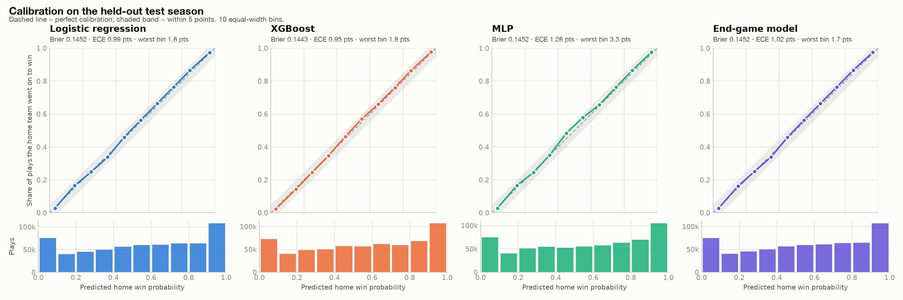

# Clutch

**NBA win probability after every play, live for tonight's games and on replay
for any game from the last two seasons.**

A score alone doesn't tell you how safe a lead is. Up 8 with two minutes left
and up 8 at halftime are very different situations. Clutch puts a number on it:
a model trained on four seasons of play-by-play estimates the home team's
chance to win from any moment in a game, and the web app draws it as a line
that moves with each play, with the biggest swing called out.

<!-- TODO(logan): demo GIF of a close game replayed at 60x (docs/BLOCKERS.md B6) -->
<!--  -->

## How it works



**Features, one row per play** (`pipeline/features.py`):

| Feature | Definition |
| --- | --- |
| `margin` | Home score minus away score |
| `seconds_left` | Seconds left in regulation; in overtime, seconds left in the OT period |
| `is_ot` | 1 if overtime |
| `home_possession` | 1 if home has the ball, inferred from the last made shot, final made free throw, rebound or turnover (0.5 when unknown) |
| `strength_gap` | Home minus away season-to-date point differential per game, using only earlier games; blended toward last season's for each team's first 10 games |
| `margin_x_time` | `margin / sqrt(seconds_left + 1)`, helps the linear baseline |

Label: 1 if the home team won.

**Split by season, never by row.** Train 2021-22 to 2023-24, validate (early
stopping, model selection) on 2024-25, test on 2025-26. Plays within a game
are nearly identical, so a random split would leak answers into the test set.
`tests/test_split.py` checks that no test-season game appears in training.

**Models** (`model/train.py`): logistic regression baseline; XGBoost with
monotone constraints on margin, possession and strength; a PyTorch MLP (two
hidden layers of 32, sigmoid output, binary cross-entropy). The MLP's weights
are exported to numpy, so the deployed API doesn't need torch.

## Results

<!-- results:start -->
Pending the real data pull. `make train` fills this section in from
`reports/eval.md` (see [docs/BLOCKERS.md](docs/BLOCKERS.md), B1).
<!-- results:end -->

<!-- TODO(logan): uncomment once reports/calibration*.png exist from real data
<picture>
  <source media="(prefers-color-scheme: dark)" srcset="reports/calibration-dark.png">
  
</picture>
-->

### Acceptance criteria

- [ ] XGBoost or the MLP beats the logistic regression baseline on Brier score for the test season
- [ ] Calibration plot saved to the README, with every bin within 5 points of the diagonal
- [x] No game from the test season appears in training data, checked by a test (`tests/test_split.py`)
- [ ] Replay works on the deployed site for any game from the last two seasons
- [ ] Live mode tested during at least one real game, deployed or local
- [ ] Demo GIF: a close game replayed at 60x, with the biggest swing card appearing

## Run it

Requires Python 3.12, [uv](https://docs.astral.sh/uv/), Node 20+.

```bash
make setup          # Python venv (with torch for training) + web deps
```

**Without network access** (simulated games, clearly labeled as such in the UI):

```bash
make synthetic      # generate ~6,000 simulated games, train, evaluate, precompute
make api-fake       # API on :8000 with simulated "live" games
make web            # web app on :5173
```

**With real NBA data:**

```bash
make pull           # 1-2 hours; cached per game, safe to stop and rerun
make features
make train          # trains all three models, writes reports/ and the README results
make precompute     # per-game probability series for replay
make api            # live mode polls cdn.nba.com
make web
make test
```

## API

| Endpoint | Purpose |
| --- | --- |
| `GET /games/today` | Tonight's games with status, score and current probability |
| `GET /games?team=TOR&season=2025-26` | Past games for replay (also `q`, `date`, `sort=date\|swing\|close`, paging) |
| `GET /games/{id}` | One game's summary |
| `GET /games/{id}/series` | Full probability series for a finished game, plus its biggest swing |
| `WS /games/{id}/replay?speed=10` | Streams a finished game play by play; accepts `pause`, `play`, `speed`, `restart` |
| `WS /games/{id}/live` | Pushes each new play's probability during a live game |
| `GET /health`, `GET /meta` | Status, data source, model; seasons and teams for filters |

Every pushed message carries the play description, clock, score, probability
and the change from the previous play. Replay is served from precomputed files
and never calls the NBA site; live mode polls every 5 seconds, well inside the
15-second target.

## Layout

| Folder | What lives there |
| --- | --- |
| `pipeline/` | Data pull, canonical play schema (historical and live feeds share it), features, team strength, synthetic generator |
| `model/` | Training, evaluation report, `predict(state)` |
| `api/` | FastAPI app, precompute, replay streaming, live hub |
| `web/` | Vite + React + Recharts app |
| `tests/` | Feature, split, model, API, framing tests |
| `docs/` | [Build log](docs/BUILD_LOG.md), [open questions](docs/QUESTIONS.md), [blockers](docs/BLOCKERS.md), [design notes](docs/DESIGN.md) |

Deploy: `render.yaml` (API on Render) and `web/vercel.json` (web on Vercel).

## Notes

* Possession is inferred with a last-event heuristic; it's 0.5 at the start
  of each period until the first possession-deciding play.
* After a finished game's last play the chart shows the final result (100% or
  0%); the model's own output is what the evaluation scores.
* Play-by-play from NBA.com via [nba_api](https://github.com/swar/nba_api).
  Not affiliated with the NBA or its teams.
