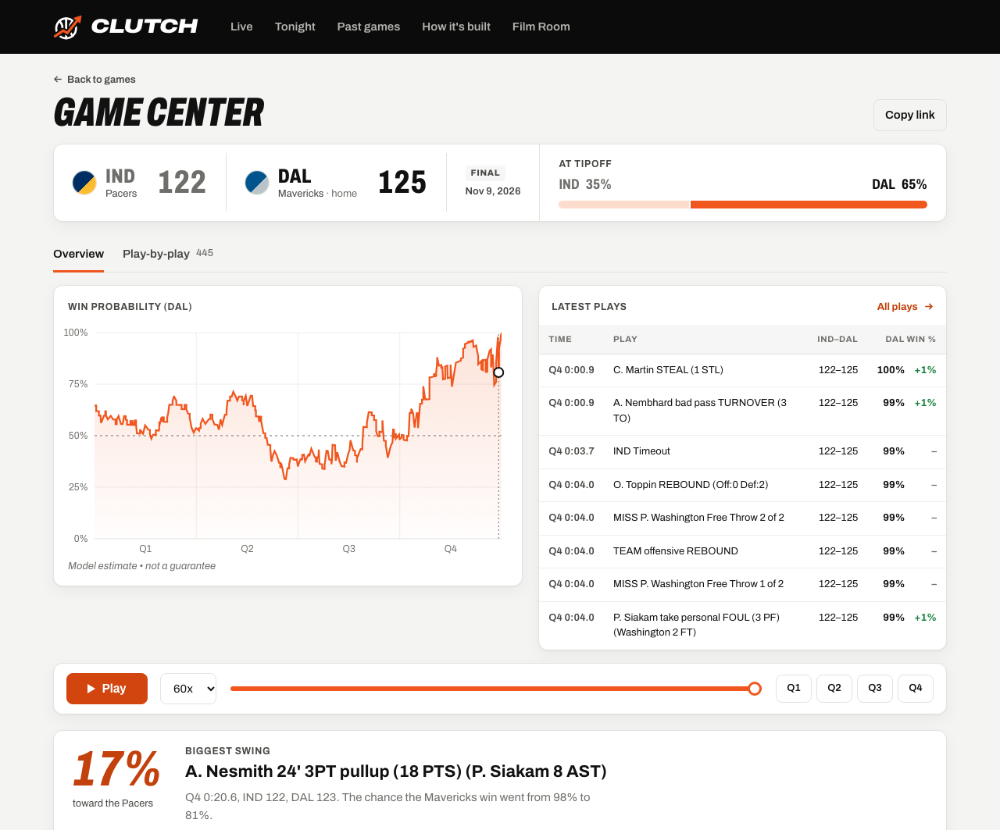
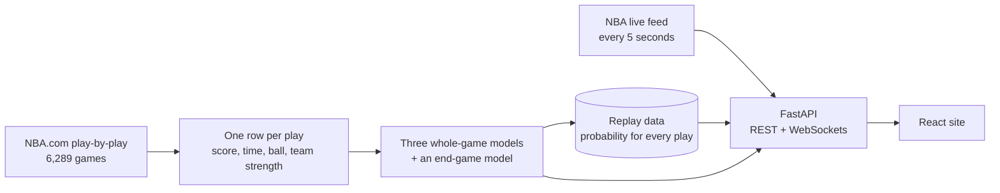

# Clutch

**NBA win probability after every play, from a model trained on three seasons of play-by-play and tested on a season it never saw.**



**[Open it at clutchnba.onrender.com](https://clutchnba.onrender.com)** · Built by [Logan Li](https://www.linkedin.com/in/logan-li-9089b7216/)

## What it is

Up 8 with two minutes left is close to safe. Up 8 at halftime wins about three
times in four. Clutch puts a number on that: after every play it estimates the
home team's chance to win and draws it as a line, so you can see which plays
actually swung the game.

- **Live:** tonight's games update a few seconds after each play.
- **Replay:** every game from 2024-25 on, at 1x, 10x or 60x, with the play-by-play beside the chart.
- **Biggest swings:** the home page leads with the wildest finishes from today, or from yesterday until today's games tip off.
- **Film Room:** notes from building it: what broke, what I tried, and what the numbers said.

## How it works



1. **Data.** 6,289 regular-season games (3.1 million plays) from NBA.com
   through `nba_api`, cached per game. The real feed has quirks the code
   handles and tests: neutral-site games list both teams as away, and
   instant-replay reviews get logged after the fact with an earlier clock.
2. **Features.** Every play becomes a snapshot: the score margin, time left,
   overtime, who has the ball, the gap in team strength (season-to-date point
   differential, using only earlier games), and the lead scaled by time left.
3. **Models.** A logistic regression baseline, XGBoost and a small PyTorch
   network train on 2021-22 to 2023-24. A fourth, the **end-game model**,
   trains only on the last three minutes and takes over from the best
   whole-game model as the clock runs from 3:00 to 2:00, so the line never
   jumps.
4. **Picking and grading.** The 2024-25 season picks the model; 2025-26, held
   out of everything, grades it. Splits are by season, never by play, and a
   test checks that no test-season game reaches training.
5. **Serving.** FastAPI streams replays and live games over WebSockets. Live
   games come from the NBA's live feed and go through the same feature code
   as training. The neural network runs from exported numpy weights, so the
   server doesn't need PyTorch.

## Results

<!-- results:start -->
Test season **2025-26**: 1,229 games, 621,370 plays. Trained on 2021-22, 2022-23, 2023-24: **3,685 games, 1,800,726 plays**. Production model (best validation Brier): **End-game model**.

| Metric | Logistic regression | XGBoost | MLP | End-game model |
| --- | --- | --- | --- | --- |
| Brier score | 0.1452 | 0.1443 | 0.1452 | 0.1452 |
| Log loss | 0.4375 | 0.4340 | 0.4371 | 0.4370 |
| Expected calibration error | 0.0099 | 0.0095 | 0.0126 | 0.0102 |
| Brier score, last 2 minutes only | 0.0471 | 0.0459 | 0.0475 | 0.0459 |

- [x] XGBoost or the MLP beats the logistic regression baseline on test Brier (XGBoost, MLP, End-game model)
- [x] Production model (End-game model) has every calibration bin within 5 points of the diagonal (bins with ≥200 plays)

<picture>
  <source media="(prefers-color-scheme: dark)" srcset="reports/calibration-dark.png">
  
</picture>

Full report, including scores by game phase and sanity checks: [reports/eval.md](reports/eval.md).
<!-- results:end -->

## Engineering highlights

- **Caught a model memorizing games.** XGBoost kept losing to the simple
  baseline. Team strength is one number per game and nearly unique to it, so
  the trees were using it to look up how training games ended. Rounding it,
  letting it combine only with time, and requiring bigger leaves fixed that:
  XGBoost now beats the baseline on the test season (Brier 0.1443 vs 0.1452).
- **A model for the last three minutes.** Close finishes are 0.7% of the
  training plays, and it showed: down 2 with the ball and 10 seconds left, the
  original model gave the home team 5%; in 82 real games they won 18%. The
  end-game model says 15%, and it cut the error in close finishes by 5%.
- **Calibrated.** On the test season, when the model on the site says 70%,
  the home team wins about 70% of the time: all ten calibration bins land
  within 2 points.
- **Every change measured, kept or reverted on held-out data.** Six
  experiments, each with a hypothesis, a commit and validation numbers in
  [docs/EXPERIMENTS.md](docs/EXPERIMENTS.md). Two were kept, three reverted,
  one was a check. [docs/evidence/](docs/evidence/) keeps every version's
  numbers and charts, scored on the same 12 real game moments.
- **Inputs checked against the source.** The possession guess matches the
  NBA's own possession field on 90% of plays in the last 30 seconds; timeout
  and team-foul counts match the NBA's own counts on 99.9% of plays.
- **One play schema, live and historical.** Both NBA feeds are normalized
  into the same columns, so a live game is scored with exactly the features
  the model trained on.
- **Ready for the public internet.** Per-visitor rate limits, caps on open
  streams, an origin check, input validation, a strict Content Security
  Policy and security headers. Dependency audits are clean
  ([docs/SECURITY.md](docs/SECURITY.md)).
- **73 tests**, including the train/test leak check, the timeout and foul
  rules, the end-game hand-over and the deploy config.

## Built with

Python · pandas · scikit-learn · XGBoost · PyTorch · FastAPI · WebSockets ·
React · TypeScript · Vite · Recharts · `nba_api` · Render

## Status

Live at [clutchnba.onrender.com](https://clutchnba.onrender.com). The replay
library covers 2024-25 through November 9, 2026; newer finished games are
scored on demand from the NBA's live feed. It runs on Render's free plan, so
the first visit after a quiet spell takes about a minute while the server
wakes up.

## Run it locally

Requires Python 3.12, [uv](https://docs.astral.sh/uv/) and Node 22 or later.

```bash
make setup          # Python environment (with the training extras) and web dependencies
```

Try it without network access, on simulated games (labeled as such in the app):

```bash
make synthetic      # simulate ~6,000 games, train and evaluate
make api-fake       # API on :8000, with simulated "live" games
make web            # site on http://localhost:5173
```

With real NBA data:

```bash
make pull           # about 2 hours; cached per game, safe to stop and restart
make features train precompute
make api            # live mode polls the NBA's live feed
make web
make test
```

`make refresh` adds games played since the last pull and rebuilds the replay
data without retraining. `make explore` writes a page for looking inside the
models (`reports/explorer.html`).

## Repository layout

| Path | Contents |
| --- | --- |
| [`pipeline/`](pipeline/) | Data pull, the shared play schema, features, team strength, simulated games |
| [`model/`](model/) | Training, evaluation, `predict()`; trained models in [`model/artifacts/`](model/artifacts/) |
| [`api/`](api/) | FastAPI app, replay and live streaming, latest-day swings, security guard |
| [`web/`](web/) | The site (React, Vite, Recharts); Film Room posts in [`web/src/film-room/`](web/src/film-room/) |
| [`scripts/`](scripts/) | Model explorer, evidence snapshots, possession check, screenshots |
| [`tests/`](tests/) | Unit, API and real-data tests |
| [`docs/`](docs/) | [Experiments](docs/EXPERIMENTS.md), [evidence](docs/evidence/README.md), [security](docs/SECURITY.md), [build log](docs/BUILD_LOG.md) |
| [`reports/`](reports/) | Test-season report and calibration charts |

## License

The code is under the [MIT License](LICENSE). NBA data, team names and logos
belong to the NBA and its teams and are not covered by the license. Clutch is
not affiliated with the NBA.
