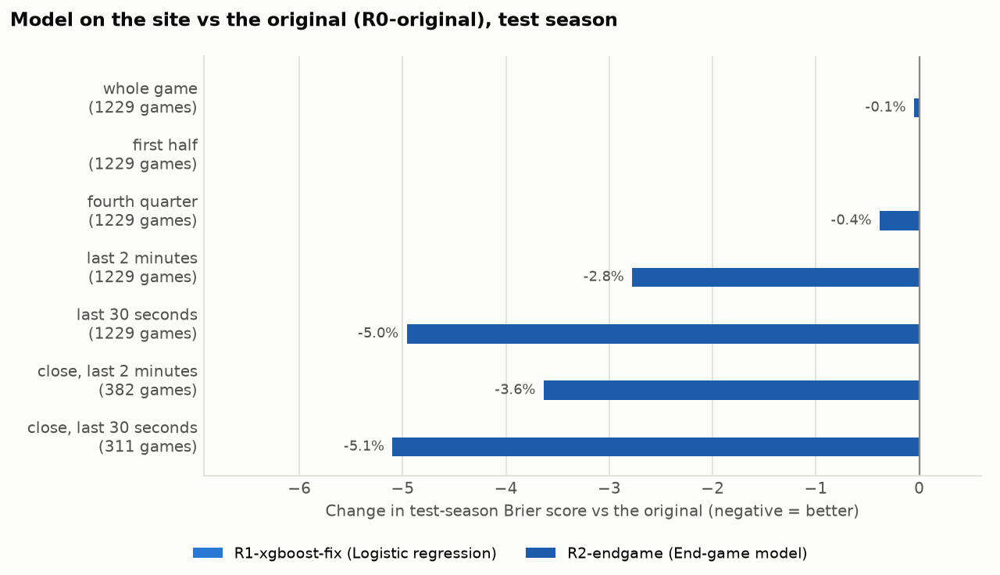
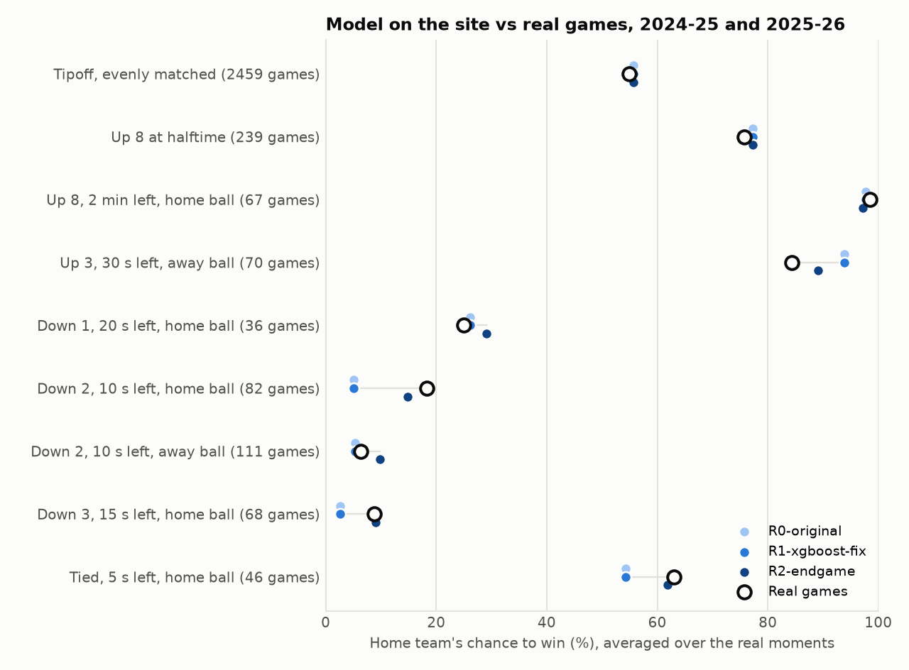

# Before and after

Generated by `docs/evidence/compare.py` from the numbers in `docs/evidence/runs/`. Don't edit by hand; rerun the script.

## Versions

| Run | What changed | Commit | Model on the site | Trained on |
| --- | --- | --- | --- | --- |
| R0-original | Original: first full real-data training run | `93f8cd9` | Logistic regression | 2021-22, 2022-23, 2023-24: 3,685 games, 1,800,726 plays |
| R1-xgboost-fix | E3: XGBoost no longer memorizes training games | `79dbcb2` | Logistic regression | 2021-22, 2022-23, 2023-24: 3,685 games, 1,800,726 plays |
| R2-endgame | E4: separate end-of-game model, blended in from 3:00 to 2:00 | `ad0444f` | End-game model | 2021-22, 2022-23, 2023-24: 3,685 games, 1,800,726 plays |

## Model on the site, test season

Brier score (lower is better). Regulation only for the late-game rows; "close" = within 3 points.

| Situation | Plays | Games | R0-original | R1-xgboost-fix | R2-endgame |
| --- | --- | --- | --- | --- | --- |
| whole game | 621,370 | 1,229 | 0.1452 | 0.1452 | 0.1452 |
| first half | 308,523 | 1,229 | 0.1849 | 0.1849 | 0.1849 |
| fourth quarter | 156,281 | 1,229 | 0.0786 | 0.0786 | 0.0783 |
| last 2 minutes | 32,756 | 1,229 | 0.0442 | 0.0442 | 0.0430 |
| last 30 seconds | 10,437 | 1,229 | 0.0493 | 0.0493 | 0.0469 |
| close, last 2 minutes | 8,284 | 382 | 0.1565 | 0.1565 | 0.1508 |
| close, last 30 seconds | 4,194 | 311 | 0.1192 | 0.1192 | 0.1132 |

## Every model, close finishes (last 30 seconds, within 3 points)

| Run | Model | Validation Brier | Test Brier | Test games |
| --- | --- | --- | --- | --- |
| R0-original | Logistic regression (on the site) | 0.1271 | 0.1192 | 311 |
| R0-original | XGBoost | 0.1257 | 0.1152 | 311 |
| R0-original | Neural net | 0.1226 | 0.1185 | 311 |
| R1-xgboost-fix | Logistic regression (on the site) | 0.1271 | 0.1192 | 311 |
| R1-xgboost-fix | XGBoost | 0.1245 | 0.1151 | 311 |
| R1-xgboost-fix | Neural net | 0.1226 | 0.1185 | 311 |
| R2-endgame | Logistic regression | 0.1271 | 0.1192 | 311 |
| R2-endgame | XGBoost | 0.1245 | 0.1151 | 311 |
| R2-endgame | Neural net | 0.1226 | 0.1185 | 311 |
| R2-endgame | End-game model (on the site) | 0.1215 | 0.1132 | 311 |

## Situations

Real games: 2024-25 and 2025-26 (never trained on), each game counted once. Model columns are the model on the site, averaged over those same real moments.

| Situation | Real games | Home won | R0-original | R1-xgboost-fix | R2-endgame |
| --- | --- | --- | --- | --- | --- |
| Tipoff, evenly matched | 2459 | 54.9% | 55.7% | 55.7% | 55.7% |
| Up 8 at halftime | 239 | 75.7% | 77.3% | 77.3% | 77.3% |
| Up 8, 2 min left, home ball | 67 | 98.5% | 97.7% | 97.7% | 97.2% |
| Up 3, 30 s left, away ball | 70 | 84.3% | 93.8% | 93.8% | 89.1% |
| Down 1, 20 s left, home ball | 36 | 25.0% | 26.2% | 26.2% | 29.1% |
| Down 2, 10 s left, home ball | 82 | 18.3% | 5.0% | 5.0% | 14.8% |
| Down 2, 10 s left, away ball | 111 | 6.3% | 5.3% | 5.3% | 9.8% |
| Down 3, 15 s left, home ball | 68 | 8.8% | 2.6% | 2.6% | 9.0% |
| Tied, 5 s left, home ball | 46 | 63.0% | 54.2% | 54.2% | 61.8% |

## Real game moments

Frozen in `cases.csv`: the original model's 12 worst calls in close finishes of 2025-26. Upsets happen even with a perfect model; what matters is how confident the model was.

| Case | Game | Moment | Result | R0-original | R1-xgboost-fix | R2-endgame |
| --- | --- | --- | --- | --- | --- | --- |
| C01 | 2026-03-10 CHI at GSW (`0022500943`) | Q4 0:01.4, Home up 2, away ball | Home lost 124-130 in overtime | 99.9% | 99.9% | 98.4% |
| C02 | 2025-11-10 WAS at DET (`0022500199`) | Q4 0:01.9, Home down 3, home ball | Home won 137-135 in overtime | 0.1% | 0.1% | 1.4% |
| C03 | 2026-03-14 DEN at LAL (`0022500974`) | Q4 0:05.2, Home down 3, home ball | Home won 127-125 in overtime | 0.2% | 0.2% | 1.8% |
| C04 | 2026-01-07 TOR at CHA (`0022500516`) | Q4 0:01.6, Home up 2, away ball | Home lost 96-97 | 99.8% | 99.8% | 98.2% |
| C05 | 2026-03-21 LAL at ORL (`0022501024`) | Q4 0:05.5, Home up 3, away ball | Home lost 104-105 | 99.8% | 99.8% | 96.9% |
| C06 | 2026-02-27 CLE at DET (`0022500858`) | Q4 0:04.7, Home down 3, home ball | Home won 122-119 in overtime | 0.3% | 0.3% | 1.7% |
| C07 | 2025-11-16 ORL at HOU (`0022500236`) | Q4 0:01.4, Home down 2, home ball | Home won 117-113 in overtime | 0.4% | 0.4% | 1.6% |
| C08 | 2025-12-21 HOU at SAC (`0022500401`) | Q4 0:17.1, Home down 3, home ball | Home won 125-124 in overtime | 0.7% | 0.7% | 9.9% |
| C09 | 2025-11-29 TOR at CHA (`0022500294`) | Q4 0:12.6, Home down 3, home ball | Home won 118-111 in overtime | 0.8% | 0.8% | 8.0% |
| C10 | 2025-12-14 CHA at CLE (`0022501218`) | Q4 0:13.2, Home up 3, away ball | Home lost 111-119 in overtime | 99.1% | 99.1% | 95.3% |
| C11 | 2026-03-21 MIA at HOU (`0022501027`) | Q4 0:00.2, Home down 1, home ball | Home won 123-122 | 1.2% | 1.2% | 7.2% |
| C12 | 2025-12-18 HOU at NOP (`0022500375`) | Q4 0:09.4, Home down 2, home ball | Home won 133-128 in overtime | 1.2% | 1.2% | 11.9% |

## Charts

