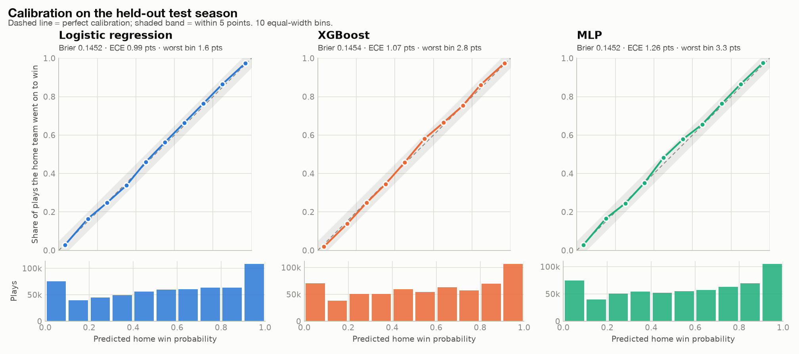

# Evaluation report

Test season **2025-26**: 1,229 games, 621,370 plays. Trained on 2021-22, 2022-23, 2023-24: **3,685 games, 1,800,726 plays**. Production model (best validation Brier): **Logistic regression**.

## Headline numbers

| Metric | Logistic regression | XGBoost | MLP |
| --- | --- | --- | --- |
| Brier score | 0.1452 | 0.1454 | 0.1452 |
| Log loss | 0.4375 | 0.4371 | 0.4371 |
| Expected calibration error | 0.0099 | 0.0107 | 0.0126 |
| Brier score, last 2 minutes only | 0.0471 | 0.0459 | 0.0475 |

## Acceptance checks

- [x] XGBoost or the MLP beats the logistic regression baseline on test Brier (MLP)
- [x] Production model (Logistic regression) has every calibration bin within 5 points of the diagonal (bins with ≥200 plays)

## Calibration

## Brier score by game phase

| Metric | Logistic regression | XGBoost | MLP |
| --- | --- | --- | --- |
| First half | 0.1849 | 0.1852 | 0.1838 |
| Third quarter | 0.1334 | 0.1340 | 0.1345 |
| Fourth quarter | 0.0786 | 0.0781 | 0.0794 |
| Last 2 minutes | 0.0471 | 0.0459 | 0.0475 |
| Overtime | 0.1410 | 0.1399 | 0.1545 |

## Sanity checks

| Metric | Logistic regression | XGBoost | MLP |
| --- | --- | --- | --- |
| Final play: mean probability on the winner | 1.000 | 0.993 | 0.998 |
| Final play: share above 0.95 | 1.000 | 0.999 | 0.992 |
| Tipoff: correlation with strength_gap | 0.997 | 0.975 | 0.981 |
| Worst calibration bin (points) | 1.6 | 2.8 | 3.3 |
